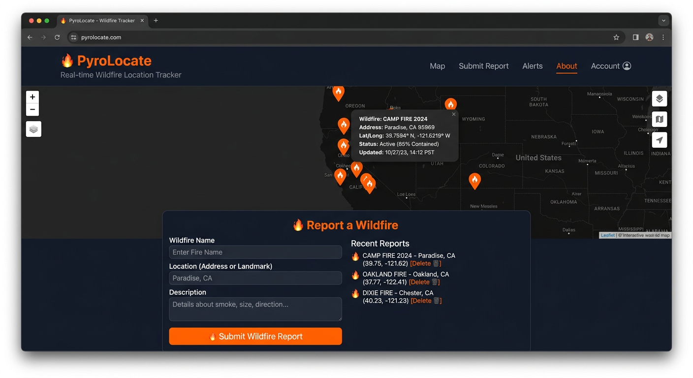
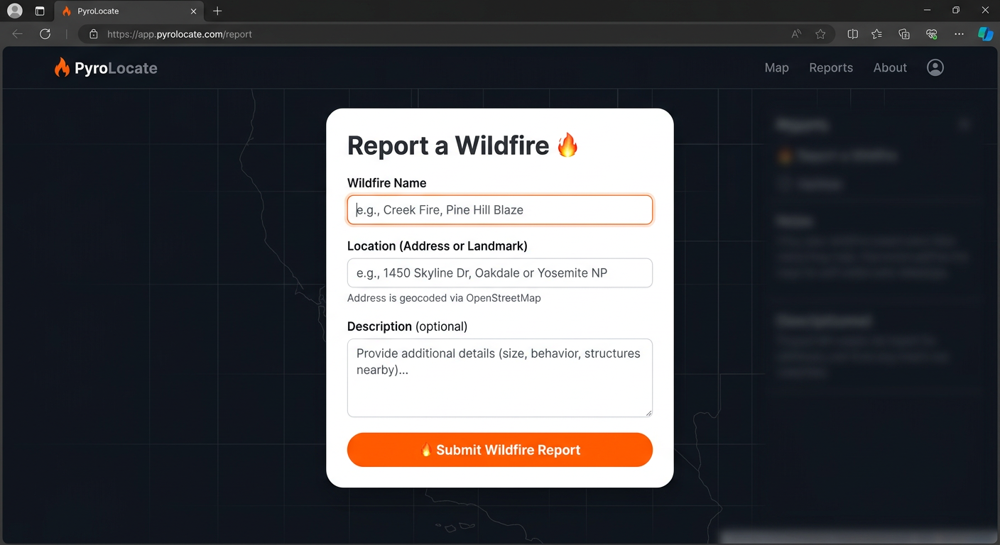

# 🔥 PyroLocate

**PyroLocate** is a lightweight, open-source wildfire location tracker. Report wildfires by name, address, and description — addresses are geocoded live via OpenStreetMap Nominatim and every report appears on an interactive Leaflet map.

Built with **Spring Boot 3.3.4**, **Java 21**, **Thymeleaf**, **Spring Data JPA**, and **H2**.

## 📸 Preview

| Map view | Report form |
|---|---|
|  |  |

> The images above are preview mockups of the running application.

## ✨ Features

- 📍 **Report wildfires** — name, address or landmark, and an optional description
- 🗺️ **Interactive map** — 🔥 markers with clickable popups (Leaflet + OpenStreetMap tiles)
- 🔍 **Live geocoding** — addresses are converted to coordinates via OpenStreetMap Nominatim, with smart fallback if the first lookup fails
- 🗂 **Reports list** — view all submitted reports and delete any entry
- 🌐 **JSON API** — `GET /api/wildfires` returns all reports as JSON
- 💾 **H2 database** — in-memory storage with web console at `/h2-console`
- 📱 **Responsive dark UI** — orange-themed interface that works on mobile and desktop

## 🛠 Tech stack

| Layer | Technology |
|---|---|
| Backend | Spring Boot 3.3.4, Java 21, Spring Web, Spring Data JPA |
| Database | H2 (in-memory) |
| Templating | Thymeleaf |
| Mapping | Leaflet.js + OpenStreetMap |
| Geocoding | OpenStreetMap Nominatim |
| Build | Apache Maven |

## 🚀 Getting started

**Prerequisites:** JDK 21+ and Apache Maven 3.9+

```bash
# Clone the repo
git clone https://github.com/sripadre4-lgtm/PyrolocateV1.git
cd PyrolocateV1/pyrolocate

# Run the application
mvn spring-boot:run
```

Then open **http://localhost:8080** in your browser.

**H2 console:** http://localhost:8080/h2-console  
JDBC URL: `jdbc:h2:mem:pyrolocatedb` (username `sa`, no password)

> ⚠️ The database is in-memory, so reported wildfires reset when the application restarts.

## 🔌 API reference

| Method | Endpoint | Description |
|---|---|---|
| `GET` | `/` | Home page with map, report form, and report list |
| `GET` | `/api/wildfires` | JSON list of all reported wildfires |
| `POST` | `/add` | Submit a new wildfire report (form) |
| `POST` | `/delete/{id}` | Delete a wildfire report by ID |

## 📁 Project structure

```
PyrolocateV1/
├── README.md
├── LICENSE
├── .gitignore
├── assets/screenshots/          # preview mockups
└── pyrolocate/                  # Spring Boot application
    ├── pom.xml
    ├── src/main/java/com/pyrolocate/
    │   ├── PyrolocateApplication.java
    │   ├── Wildfire.java            # JPA entity
    │   ├── WildfireController.java  # MVC controller + API
    │   └── WildfireRepository.java  # JPA repository
    ├── src/main/resources/
    │   ├── application.properties
    │   └── templates/index.html     # Thymeleaf UI (Leaflet map + form)
    └── src/test/java/com/pyrolocate/
        └── PyrolocateApplicationTests.java
```

## 🗺️ How geocoding works

When you submit the report form, the browser sends the address to OpenStreetMap Nominatim. If the exact address isn't found, the app automatically retries with a broader fallback (e.g. stripping the street name and keeping "City, State") so you still get usable coordinates. The latitude and longitude are saved with the report and plotted on the map.

## 🗺️ Roadmap

- Persistent database (PostgreSQL / MySQL) instead of in-memory H2
- User accounts and authentication
- Fire severity, date, and status tracking
- Email or SMS alerts for new reports
- Docker support (`Dockerfile` + `docker-compose`)

## 🤝 Contributing

Contributions are welcome! Fork the repo, create a feature branch, and open a pull request. Please keep the commit style consistent and update the README when adding features.

## 📄 License

This project is licensed under the MIT License — see [LICENSE](LICENSE).

---

Made with ❤️ and ☕ for wildfire awareness.